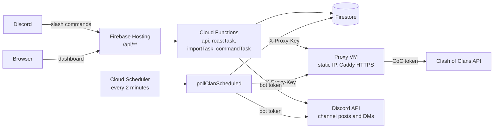

# Bimgus

Bimgus is a Clash of Clans companion for one clan. It has three parts:

- **Discord notifications**: joins and departures, promotions, Town Hall upgrades, live war attacks and results, missed-attack reminders, CWL rounds, Raid Weekend districts and Clan Games.
- **Slash commands**: members link their accounts, import their village export and check upgrades, heroes, defenses, troops and spells. Bimgus DMs them when an upgrade finishes.
- **Web dashboard**: a public page for war status, roster audit, capital raids and Clan Games, plus a settings page that only leaders can use.

This guide sets up your own copy, for your own clan and Discord server. Allow about an hour. What's changed in each release is in the [changelog](CHANGELOG.md).

> This material is unofficial and is not endorsed by Supercell. For more information see Supercell's Fan Content Policy: <https://www.supercell.com/fan-content-policy>.

## What you'll set up

| Piece | What it does | Cost |
| --- | --- | --- |
| Firebase project (Blaze plan) | Hosts the dashboard, runs the functions, stores data in Firestore | Usually within the free allowances; Blaze needs a billing account |
| Proxy VM (Google Compute Engine `e2-micro`) | Gives Bimgus one fixed IP for the Clash of Clans API and holds your CoC token | The VM is in Google's free tier in some US regions; the static IP may be billed |
| Discord application | The bot, its slash commands and its emojis | Free |
| Clash of Clans developer key | Read access to clan, war and player data | Free |
| Gemini API key (optional) | Writes `/roast` replies; without it Bimgus uses built-in roasts | Free tier available |

**Why a VM?** Clash of Clans API keys only work from the IP addresses you list. Cloud Functions don't have a fixed outgoing IP, so every request goes through a small proxy on a VM with a static IP. The proxy checks a shared key (`PROXY_KEY`), only allows read requests to clan, player and CWL endpoints, limits traffic to 20 requests a second, and adds your CoC token. The token never leaves the VM.

## How it fits together



## Before you start

You need:

- [Node.js 22](https://nodejs.org/) and npm
- The [Firebase CLI](https://firebase.google.com/docs/cli): `npm install -g firebase-tools`
- The [Google Cloud CLI](https://cloud.google.com/sdk/docs/install) (`gcloud`)
- A Google account with a billing account (needed for Firebase's Blaze plan)
- A Discord server where you have the **Manage Server** permission
- A [Clash of Clans developer account](https://developer.clashofclans.com)
- `openssl`, for generating keys (preinstalled on macOS and Linux)

## 1. Get the code

```bash
git clone https://github.com/<you>/bimgus.git
cd bimgus
npm --prefix functions ci
npm --prefix frontend ci
```

## 2. Create the Firebase project

1. In the [Firebase console](https://console.firebase.google.com/), create a project. Note its **project ID**, which you'll need throughout.
2. Upgrade it to the **Blaze** plan. Cloud Functions, Cloud Scheduler, Cloud Tasks and Secret Manager all require it. In Google Cloud Billing, set a budget alert for a small amount so you hear about any surprise costs.
3. Create a **Firestore** database in Native mode, named `(default)`. Pick a location near `us-central1`, because the functions run there.
4. Turn on **Hosting**. No extra setup is needed; deploying creates the site.
5. On your machine, sign in and point the repo at your project:

   ```bash
   firebase login
   cp .firebaserc.example .firebaserc
   ```

   Then replace `your-project-id` in `.firebaserc` with your project ID. You can delete the `staging` line unless you plan to use a [staging project](#optional-a-staging-project).

Your dashboard will be at `https://<your-project-id>.web.app`.

## 3. Set up the proxy VM

The VM lives in a Google Cloud project; your Firebase project works. Google's free tier covers one `e2-micro` VM in `us-west1`, `us-central1` or `us-east1`, so use one of those regions. See [Google Cloud's free tier](https://cloud.google.com/free/docs/free-cloud-features#compute) for the current terms.

1. Sign in and turn on Compute Engine:

   ```bash
   gcloud auth login
   gcloud services enable compute.googleapis.com --project <your-project-id>
   ```

2. Copy the deploy settings and fill them in. Leave `PROXY_HOSTNAME` for now.

   ```bash
   cp deploy.env.example deploy.env
   ```

   | Key | Example |
   | --- | --- |
   | `GCP_PROJECT_ID` | your project ID |
   | `GCP_REGION` | `us-central1` |
   | `GCP_ZONE` | `us-central1-a` |
   | `PROXY_VM_NAME` | `bimgus-proxy` |
   | `PROXY_NETWORK_TAG` | `bimgus-proxy` |
   | `PROXY_FIREWALL_RULE` | `allow-bimgus-proxy` |
   | `PROXY_STATIC_IP_NAME` | `bimgus-proxy-ip` |
   | `PROXY_HOSTNAME` | filled in at step 4 |

3. Create the VM, its firewall rule and a static IP. The script prints the IP when it's done.

   ```bash
   ./deploy-proxy.sh
   ```

4. Choose the proxy's hostname. Caddy needs a hostname, not a bare IP, to get an HTTPS certificate.
   - **Simplest:** `<ip-with-dashes>.sslip.io`. For IP `203.0.113.7` that's `203-0-113-7.sslip.io`. It's a free public DNS name that always points at that IP, but your proxy then depends on sslip.io staying up.
   - **More robust:** a subdomain you own, such as `proxy.example.com`, with an A record pointing at the static IP.

   Put it in `deploy.env` as `PROXY_HOSTNAME`.

5. Install the proxy. This copies `proxy/` to the VM, installs Node 22 and Caddy, creates a locked-down `clashproxy` user and service, opens ports 80 and 443, turns on automatic security updates, and generates a random `PROXY_KEY`.

   ```bash
   ./proxy/apply-to-gce.sh
   ```

## 4. Get a Clash of Clans API key

1. At [developer.clashofclans.com](https://developer.clashofclans.com), go to **My Account → Create New Key**.
2. Under **Allowed IP addresses**, enter the VM's static IP. Nothing else needs to be listed.
3. Copy the token.
4. Put the token on the VM, and copy the `PROXY_KEY` it generated:

   ```bash
   gcloud compute ssh <PROXY_VM_NAME> --zone <GCP_ZONE> --project <your-project-id>
   sudo nano /etc/clash-proxy/env      # set COC_API_TOKEN, and copy the PROXY_KEY value
   sudo systemctl restart clash-proxy
   exit
   ```

5. Check it works:

   ```bash
   curl https://<PROXY_HOSTNAME>/health
   # {"status":"ok",...}
   curl -H "X-Proxy-Key: <PROXY_KEY>" "https://<PROXY_HOSTNAME>/v1/clans/%23<YOUR_CLAN_TAG>"
   # your clan's JSON
   ```

## 5. Create the Discord application

1. At the [Discord Developer Portal](https://discord.com/developers/applications), select **New Application** and name it.
2. **General Information**: copy the **Application ID** (`DISCORD_CLIENT_ID`) and the **Public Key** (`DISCORD_PUBLIC_KEY`).
3. **Bot**: select **Reset Token** and copy it (`DISCORD_BOT_TOKEN`). Bimgus doesn't need any privileged gateway intents.
4. **Emojis (optional)**: Bimgus uses plain Unicode emojis until you give it your own. To use custom ones, upload application emojis with these names: `crown`, `anvil`, `star`, `gold`, `elixir`, `dark_elixir`, `builder_gold`, `builder_elixir`, `shiny_ore`, `glowy_ore`, `starry_ore`, `capital_gold`, `raid`. Copy each emoji's ID for step 6.
5. Your server's ID: in Discord, turn on **User Settings → Advanced → Developer Mode**, then right-click your server and select **Copy Server ID** (`DISCORD_GUILD_ID`). With it, commands appear in your server straight away instead of within about an hour.
6. Invite the bot. Under **OAuth2 → URL Generator**, tick the scopes `bot` and `applications.commands`, and the permissions **View Channels**, **Send Messages**, **Embed Links** and **Use External Emojis**. Open the URL it generates and add the bot to your server.
7. Create the notification channels. Bimgus uses five: clan activity, war room, CWL hub, raid weekend and Clan Games. They can be any channels you like. In each one, go to **Edit Channel → Integrations → Webhooks → New Webhook** and copy the webhook URL; you'll paste these into the dashboard in step 8. Make sure the bot can see and post in each channel, because it posts there as itself so its emojis show. The webhook is only a fallback.

## 6. Configure and deploy

1. Create the functions' settings file:

   ```bash
   cp .env.example functions/.env
   ```

   | Key | Value |
   | --- | --- |
   | `COC_CLAN_TAG` | your clan tag, for example `#ABC123` |
   | `COC_API_BASE_URL` | `https://<PROXY_HOSTNAME>/v1` |
   | `COC_API_TOKEN` | leave empty; the proxy holds the token |
   | `DISCORD_CLIENT_ID`, `DISCORD_PUBLIC_KEY`, `DISCORD_BOT_TOKEN`, `DISCORD_GUILD_ID` | from step 5 |
   | `DISCORD_CLIENT_SECRET`, `DISCORD_COLEADER_ROLE_ID`, `DISCORD_LEADER_ROLE_ID` | not used yet; leave the placeholders |
   | `DISCORD_WEBHOOK_*` | leave as they are and set the webhooks in the dashboard instead |
   | `EMOJI_CROWN_ID` … `EMOJI_RAID_ID` | optional; the emoji IDs from step 5. An empty one shows a plain Unicode emoji. |
   | `GEMINI_API_KEY` | optional, from [Google AI Studio](https://aistudio.google.com/apikey); without it `/roast` uses built-in roasts |
   | `API_PING_URL` | `https://us-central1-<your-project-id>.cloudfunctions.net/api/api/ping` keeps the API warm so commands respond faster. The doubled `/api/api/` is correct. |

2. Store the two secrets in Google Secret Manager:

   ```bash
   firebase functions:secrets:set PROXY_KEY        # paste the PROXY_KEY from the VM
   openssl rand -hex 32                            # generate the dashboard's Leader Key
   firebase functions:secrets:set ADMIN_API_KEY    # paste the key you just generated
   ```

   Keep the Leader Key somewhere safe. Only your leaders should have it.

3. Deploy everything: functions, Firestore rules and indexes, and the dashboard. The deploy runs the tests and builds first.

   ```bash
   firebase deploy
   ```

   The first deploy can take several minutes while Google turns on the APIs it needs.

## 7. Connect Discord

1. In the Developer Portal, under **General Information → Interactions Endpoint URL**, enter `https://<your-project-id>.web.app/api/discord/interactions` and save. Discord sends a signed test request, and it saves only if your deploy answered it.
2. Register the slash commands:

   ```bash
   npm --prefix functions run register-commands
   ```

   (You can also do this later from the dashboard's settings page.)
3. In your server, type `/help`. Bimgus should reply with its command list.

## 8. Set up the dashboard

1. Open `https://<your-project-id>.web.app` and go to **Bot Settings**.
2. Enter the Leader Key and save it. It's stored in that browser only.
3. Paste the five webhook URLs from step 5 and select **Test** next to each one. Each channel should get a test message.
4. Choose which notifications to send, then save.

Polling starts by itself: every 2 minutes Bimgus checks the clan and posts what changed.

## Check it's working

- [ ] `https://<PROXY_HOSTNAME>/health` returns `ok`
- [ ] The dashboard shows your clan's roster
- [ ] `/help` and `/link` work in Discord
- [ ] Each webhook **Test** posts to its channel
- [ ] `firebase functions:log` shows `pollClanScheduled` running every 2 minutes with no errors

## Slash commands

| Command | What it does |
| --- | --- |
| `/help` | Lists every command |
| `/link`, `/unlink` | Link or unlink a Clash of Clans account to your Discord account |
| `/accounts` | View and manage your linked accounts |
| `/import-village` | Import your village JSON export (one file covers both villages) |
| `/status` | Running timers and every outstanding upgrade, with menus for the account, village and area |
| `/heroes` | Hero progress for your Town Hall or Builder Hall |
| `/defenses` | Defense caps, gear-ups and Hall upgrade status |
| `/troops`, `/spells` | Troop and spell progress |
| `/sixth-builder` | How close you are to unlocking the 6th Builder (B.O.B) |
| `/dms` | Turn Bimgus DMs (finished upgrades, war roster) on or off |
| `/roast` | Tag a server member for a Clash of Clans roast |

DMs only reach members who allow direct messages from server members.

## Updating

```bash
git pull
npm --prefix functions ci && npm --prefix frontend ci
firebase deploy
```

If anything in `proxy/` changed, run `./proxy/apply-to-gce.sh` as well. It restarts the proxy, which pauses polling for a few seconds. If command definitions changed, run `npm --prefix functions run register-commands` again. The [changelog](CHANGELOG.md) says when a release needs either.

## Optional: a staging project

A second Firebase project lets you test changes without posting to your real channels.

1. Create it the same way as in step 2, and add it with `firebase use --add` and the alias `staging`.
2. Create `functions/.env.staging` with any values that differ from `functions/.env`. Set `DRY_RUN_DISCORD=1` to log messages instead of sending them, and leave `API_PING_URL` empty.
3. Set both secrets in that project too (`firebase use staging`, then the same `secrets:set` commands).
4. Deploy with `firebase deploy --project staging`.

Staging can share the proxy VM. The VM's 20 requests a second are then shared too.

To see every kind of message without waiting for a war or a raid weekend, put a private test channel's webhook in `functions/.env` as `DISCORD_TEST_CHANNEL_WEBHOOK` and run `npm --prefix functions run preview-layouts`. It posts an example of each, built from made-up data, to that channel only.

## Troubleshooting

| Symptom | Likely cause |
| --- | --- |
| Discord won't save the Interactions Endpoint URL | The functions aren't deployed yet, or `DISCORD_PUBLIC_KEY` is wrong |
| `401` from the proxy | The `PROXY_KEY` secret in Firebase doesn't match `/etc/clash-proxy/env` |
| `403 accessDenied` from the CoC API | The CoC key's allowed IP isn't the VM's static IP |
| `429` from the proxy | More than 20 requests a second, usually from two projects polling at once; it recovers by itself |
| Caddy can't get a certificate | `PROXY_HOSTNAME` doesn't point at the VM, or ports 80 and 443 are blocked |
| Commands don't appear | Run `register-commands` again; without `DISCORD_GUILD_ID`, they can take up to an hour |
| Custom emojis show as `:crown:` | An `EMOJI_*_ID` setting holds an ID from a different application |
| `/roast`, `/import-village` or `/status` never finish | Check `firebase functions:log`. A `PERMISSION_DENIED` when queueing a task means the functions' service account needs the **Cloud Tasks Enqueuer** role. |

## Keep your copy private

Never commit these. `.gitignore` already covers them:

- `functions/.env`, `functions/.env.*` (tokens, webhook URLs)
- `.firebaserc` (your project IDs)
- `deploy.env` (your VM's details)
- Anything with your proxy's IP or hostname, your `PROXY_KEY` or your Leader Key

If a token ever ends up in a public commit, reset it in the Discord Developer Portal or the CoC developer portal straight away. Deleting the commit isn't enough, because clones and caches keep it.

### Commit checks

The hooks in `scripts/hooks/` block a commit that adds a secret, one of your private values or one of the files above. Turn them on once in your copy (they need [gitleaks](https://github.com/gitleaks/gitleaks), e.g. `brew install gitleaks`, and Node):

```bash
git config core.hooksPath scripts/hooks
```

Your private values are read from your git-ignored files (`.firebaserc`, `deploy.env`, `functions/.env*`). For anything else you want kept out, such as your personal email or a channel ID, add it on its own line to a `.private-values` file in the repo root, which is git-ignored too. To check every tracked file at once, run `node scripts/hooks/private-values.mjs --all`.

The **Secret scan** GitHub Action runs gitleaks on every push and pull request.

## License

[MIT](LICENSE)
